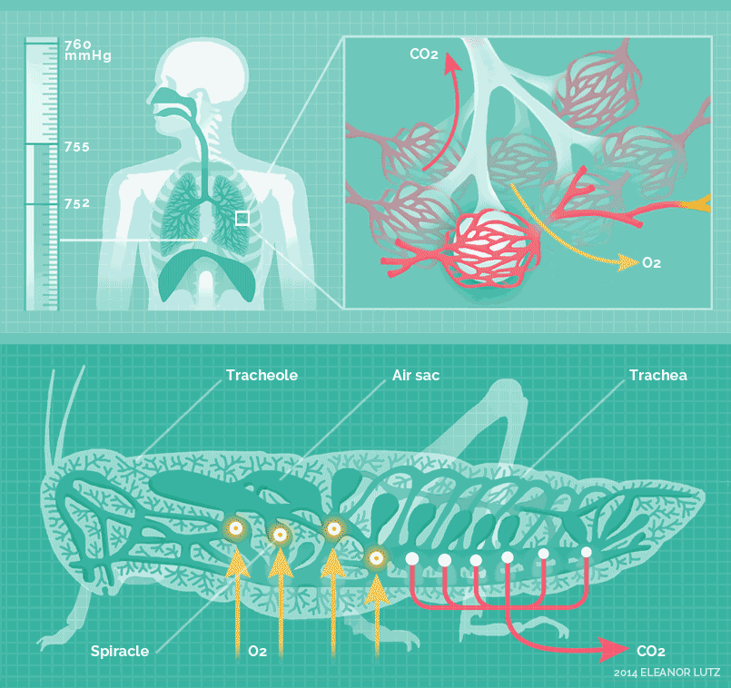
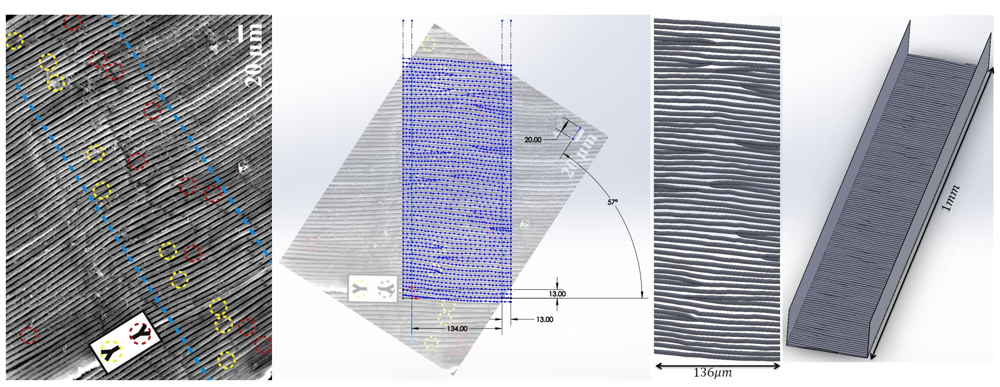
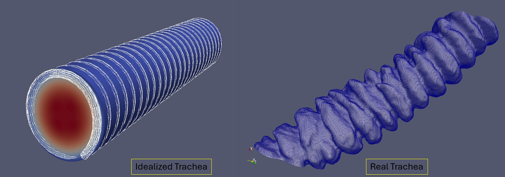
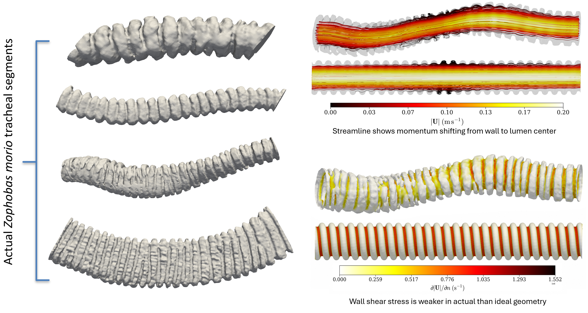
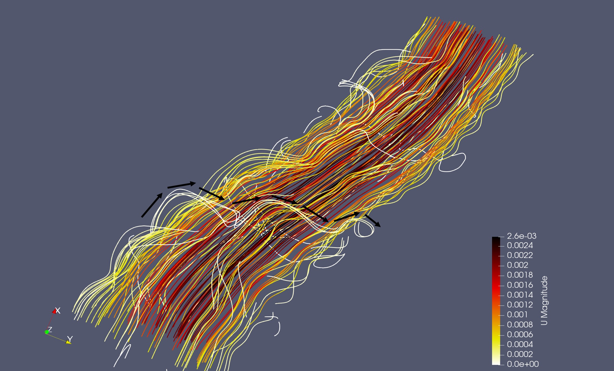
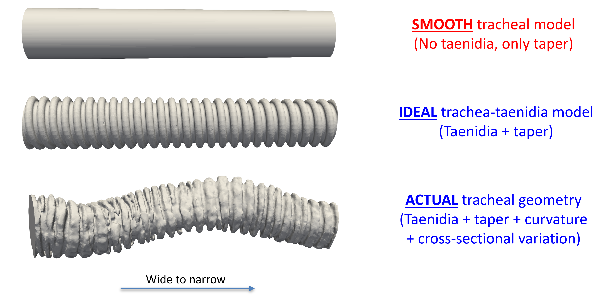
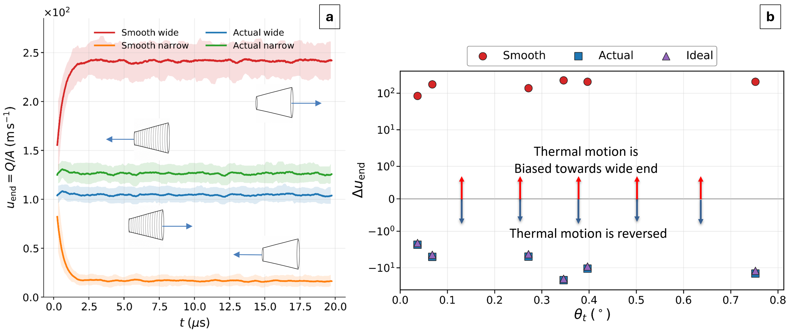
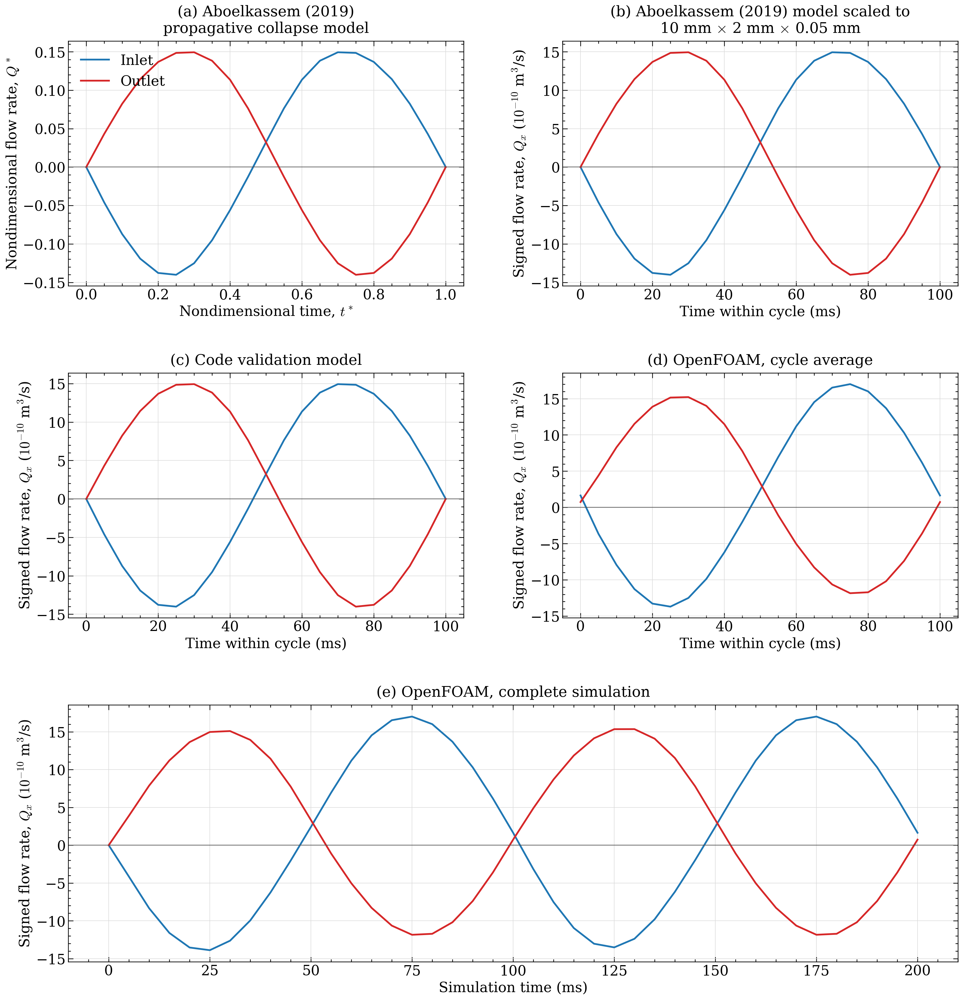
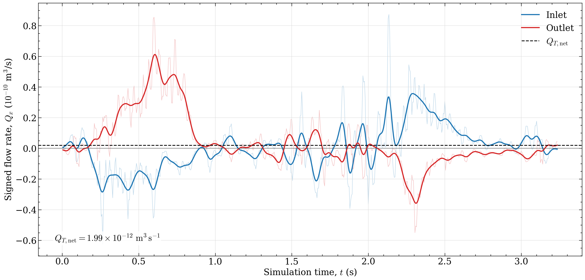
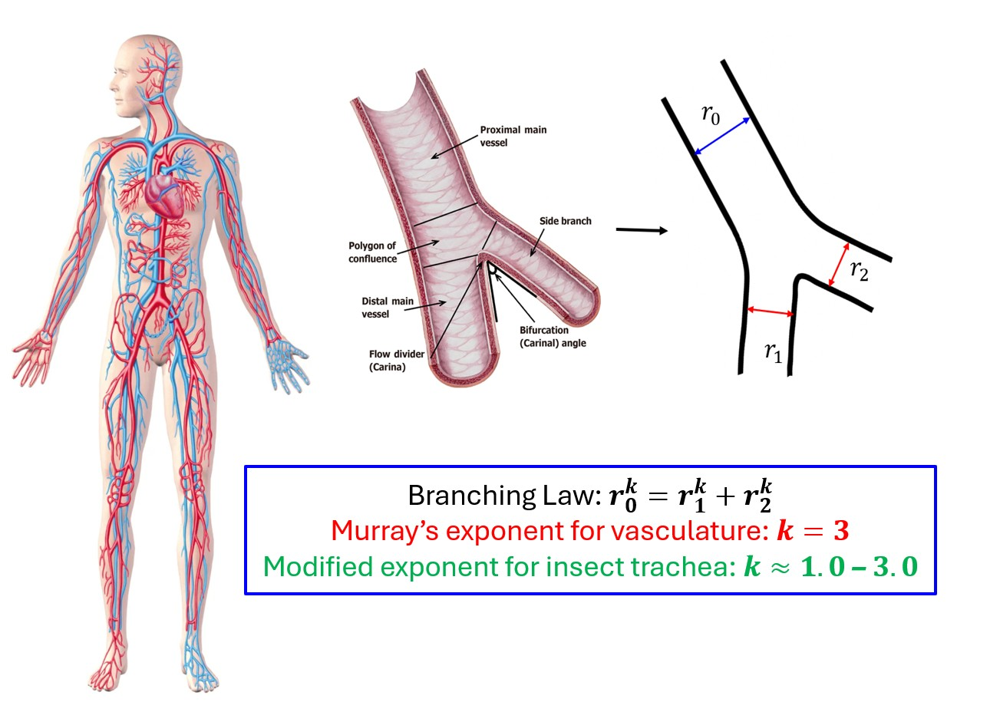

**Project supported by:** U.S. National Science Foundation (NSF) and Virginia Tech's Biological Transport (BIOTRANS) program.

<!--more-->

## Overview

Insects transport oxygen through an intricate network of air-filled tubes known as tracheae. Unlike vertebrates, this system delivers oxygen directly to tissues without relying on blood circulation. This project combines computational fluid dynamics, rarefied gas simulations, and theoretical transport modeling to investigate how microscale biological structures influence respiratory transport and network optimization.

We combine anatomy-informed geometry, continuum CFD, DSMC, deforming-mesh flow simulation, and transport theory to study how this structure affects flow.

  <figure>
    
    <figcaption>
      Human and insect respiratory transport compared side by side. Adapted from Eleanor Lutz, <a href="https://tabletopwhale.com/2014/10/24/3-different-ways-to-breathe.html">“An animated guide to breathing”</a> (2014), Tabletop Whale.
    </figcaption>
  </figure>

<blockquote class="project-takeaway">
  <strong>Related work.</strong> Check out our Nature Reviews Physics paper:
  <ul class="project-manuscript-note project-bibliography">
    <li>Saadbin Khan, Anne E. Staples (2025). <a href="https://doi.org/10.1038/s42254-025-00811-x">Mechanisms of insect respiration</a>. <em>Nature Reviews Physics</em> 7(3), 1–14.</li>
  </ul>
</blockquote>

---

## 1. Continuum CFD of Insect Tracheal Flow

### From 2D Taenidial Motifs to 3D Anatomy

Insect tracheal walls contain helical reinforcements called *taenidia* that support the tube. We hypothesize that these structures may influence microscale gas transport. We began by mimicking the two-dimensional taenidial-layer images reported by Webster et al. (2015) in a controlled CAD model. This isolated how an idealized repeating wall pattern changes flow.

  <figure>
    
    <figcaption>
      Initial literature-guided CAD model: a 2D taenidial layer, reported by Webster et al. (2015), was translated into a controlled flow domain.
    </figcaption>
  </figure>

### Image-Derived Tracheae and Flow Analysis

Through collaborators, we obtained high-resolution three-dimensional tracheal images from synchrotron X-ray imaging at Argonne National Laboratory. We processed the image volumes into stereolithography (STL) surfaces, then generated computational domains that retain the native taenidia, taper, curvature, and cross-sectional variation.

  <figure>
    
    <figcaption>
      Matched idealized and image-derived tracheal geometries used to separate the effects of organized taenidia from native anatomical complexity.
    </figcaption>
  </figure>

We used Meshmixer and **snappyHexMesh** to repair and mesh the STL surfaces, then performed flow simulations in **OpenFOAM** and post-processing in ParaView and Python. The reconstructed geometries reveal helical streamlines, center-directed momentum redistribution, and weaker wall shear than their idealized counterparts.

  <figure>
    
    <figcaption>
      Image-derived <em>Zophobas morio</em> tracheal segments and CFD results. Streamlines show momentum shifting from the structured wall toward the lumen center; the wall-shear-stress comparison is lower in the reconstructed geometry than in the idealized model.
    </figcaption>
  </figure>

  <figure>
    
    <figcaption>
      Three-dimensional streamline visualization of the reconstructed tracheal geometry, showing the helical flow structure induced by the taenidial wall.
    </figcaption>
  </figure>

  <strong>Key takeaway.</strong> Anatomy-derived taenidia do more than reinforce the wall: they reshape the flow field, redirect momentum toward the lumen center, and reduce wall shear relative to idealized geometry.
  Detailed results are included in a manuscript currently in final preparation for publication.

---

## 2. Particle-Level Molecular Transport (DSMC)

At small tracheal length scales, molecular transport and wall interactions can become important. We used Direct Simulation Monte Carlo (DSMC) to track thermal molecular motion at \(300\,\mathrm{K}\) without imposed bulk flow, isolating how tracheal geometry affects area-normalized molecular escape.

The simulation campaign separates geometric complexity systematically: a smooth tapered control, an idealized tapered model with regular taenidial windings, and a reconstructed tracheal segment that retains the observed taenidia, taper, curvature, and changing cross-section.

  <figure>
    
    <figcaption>
      DSMC geometry hierarchy. Top: smooth tapered control with no taenidia. Middle: idealized tapered trachea with regular taenidial windings. Bottom: reconstructed tracheal geometry incorporating taenidia, taper, curvature, and cross-sectional variation.
    </figcaption>
  </figure>

The particle-resolved visualization below shows molecular motion through the reconstructed tapered geometry. It makes the wide and narrow ends explicit while preserving the instantaneous particle-speed field.

  <figure>
    <video controls loop muted playsinline preload="metadata" style="width:100%; height:auto;">
      <source src="animhighres_40sec_2fps_annotated.mp4" type="video/mp4">
      Your browser does not support the video tag.
    </video>
    <figcaption>
      DSMC particle visualization in a reconstructed tapered tracheal segment. Particle color represents molecular speed at \(300\,\mathrm{K}\); the fixed annotations identify the wide and narrow ends.
    </figcaption>
  </figure>

The simulations quantify how biologically realistic microstructure changes end-to-end molecular escape.

  <figure>
    
    <figcaption>
      DSMC terminal-escape results. (a) Time-resolved area-normalized terminal escape velocity, \(u_{\mathrm{end}}=Q/A\), for one image-derived tracheal segment and its matched smooth tapered counterpart, reported separately at the wide and narrow ends. Lines are ten-snapshot averages and shaded bands show the range of the unsmoothed data. (b) Terminal asymmetry, \(\Delta u_{\mathrm{end}}=u_{\mathrm{wide}}-u_{\mathrm{narrow}}\), averaged from \(10\) to \(20\,\mu\mathrm{s}\) across six matched geometry sets and plotted against taper angle. Positive values denote a wide-end bias and negative values a narrow-end bias. Smooth, image-derived (actual), and idealized-taenidial geometries are compared.
    </figcaption>
  </figure>

  <strong>Key takeaway.</strong> Taenidial microstructure redirects thermal molecular transport toward the narrow, tissue-facing end, opposite the wide-end escape bias of smooth tapered tubes. Native ridge irregularity, curvature, and cross-sectional variation further amplify this directional effect.
  Detailed results are included in a manuscript currently in final preparation for publication.

---

## 3. Dynamic Tracheal-Collapse Simulations

Rhythmic tracheal compression is associated with convective gas exchange in insects (Socha et al., 2008) and exhibits diverse wall-motion patterns in vivo (Waters et al., 2013). We developed dynamic deforming-mesh simulations to examine how idealized propagative collapse and asymmetric wall motion displace air.

### Propagative Collapse: Analytical Benchmark and CFD Validation

The moving-wall solver was first benchmarked against the propagative rhythmic membrane-contraction model of Aboelkassem (2019). The animation compares the prescribed deformation with the dynamic mesh and computed flow fields over a complete cycle.

  <figure>
    <video controls autoplay loop muted playsinline style="width:100%; height:auto;">
      <source src="case3_four_panel.mp4" type="video/mp4">
      Your browser does not support the video tag.
    </video>
    <figcaption>
      OpenFOAM validation of the propagative membrane-contraction model of Aboelkassem (2019): prescribed wall motion, dynamic mesh, and induced flow fields over one cycle.
    </figcaption>
  </figure>

The five-panel comparison evaluates the original nondimensional analytical model, a dimensional scaling of the same model, and the cycle-resolved OpenFOAM boundary-flow history.

  <figure>
    
    <figcaption>
      Analytical and CFD comparison for propagative collapse. The figure contrasts the Aboelkassem (2019) model, its dimensional scaling, and the OpenFOAM boundary-flow response.
    </figcaption>
  </figure>

### Asymmetric Collapse Informed by Experimental Kinematics

The asymmetric wall-motion model is based on experimentally observed tracheal-compression kinematics (Waters et al., 2013). Its phase-propagating deformation provides the prescribed motion used to investigate the directional flow response to nonuniform collapse.

  <figure>
    <video controls autoplay loop muted playsinline style="width:100%; height:auto;">
      <source src="asymmetric_wall_motion_video_comparison_v2.mp4" type="video/mp4">
      Your browser does not support the video tag.
    </video>
    <figcaption>
      Asymmetric wall-motion model, informed by tracheal-compression kinematics reported by Waters et al. (2013), used to prescribe the deforming-wall simulation. Its phase-propagating motion provides the mechanism investigated for directional flow.
    </figcaption>
  </figure>

The dynamic simulation resolves the deforming mesh together with the induced velocity and pressure fields.

  <figure>
    <video controls autoplay loop muted playsinline style="width:100%; height:auto;">
      <source src="case5_four_panel.mp4" type="video/mp4">
      Your browser does not support the video tag.
    </video>
    <figcaption>
      Asymmetric tracheal-collapse simulation: prescribed wall motion, deforming mesh, velocity, and pressure evolution. The propagating deformation drives a directional flow response over the cycle.
    </figcaption>
  </figure>

  <figure>
    
    <figcaption>
      Inlet and outlet flow-rate histories for the asymmetric-collapse simulation, with a common time-averaged flow-rate reference. The nonzero cycle average quantifies the directional transport induced by the propagating collapse.
    </figcaption>
  </figure>

  <strong>Key takeaway.</strong> The phase-propagating collapse cycle produces a nonzero cycle-averaged directional flow in the model, demonstrating how tracheal wall kinematics can create unidirectional transport.
  Additional results from experimentally tracked, tracheal-collapse-driven flow are being prepared for an upcoming manuscript.

---

## 4. Modified Murray’s Law for Insect Respiratory Systems

In parallel with the simulations, we developed a theoretical framework to extend classical Murray’s law for insect respiratory transport.

The formulation incorporates:

- simultaneous advection and diffusion
- rarefaction-induced slip effects
- Knudsen transport mechanisms
- metabolic maintenance cost
- insect-specific respiratory geometry

  <figure>
    
    <figcaption>
      Modified Murray's formulation explains why insect respiratory transport deviates from classical Murray's law.
    </figcaption>
  </figure>

  <strong>Key takeaway.</strong> The resulting framework predicts branching behavior beyond classical cubic Murray scaling and connects transport optimization directly to microscale respiratory physics.
  The full model description is in the final phase of manuscript preparation.

---

## Publications & Research Output

<blockquote class="project-output">
  <h3>Journal Articles</h3>
  <ul>
    <li>Saadbin Khan, Anne E Staples (2026). <a href="/publications/j_khan2026">A tidal Murray’s law framework inspired by insect respiration</a>. <em>Nature Physics</em> (In preparation).</li>
    <li>Melissa C Kenny, Laura A Miller, Mark A Stremler, Anne E Staples, Saadbin Khan, John J Socha (2025). <a href="/publications/j_kenny2026">Does Murray’s law apply to the tracheal system in insects? A 3D study of the beetle Platynus decentis</a>. <em>Journal of Morphology</em> (In preparation).</li>
    <li>Saadbin Khan, Anne E Staples (2025). <a href="/publications/j_khan2025">Mechanisms of insect respiration</a>. <em>Nature Reviews Physics</em> 7(3), 1–14.</li>
  </ul>
</blockquote>

<blockquote class="project-output">
  <h3>Presentations</h3>
  <ul>
    <li>Saadbin Khan, Anne E Staples (2026). <a href="/presentations/igep_poster_khan2026">A modified Murray’s law for insect respiration</a>. In: <em>IGEP Annual Meeting</em>. Blacksburg, VA, USA: Virginia Tech.</li>
    <li>Saadbin Khan, Anne E Staples (2025). <a href="/presentations/aps_khan2025">A modified Murray’s law for insect respiration</a>. In: <em>Bulletin of the American Physical Society</em>. Houston, TX, USA: APS.</li>
    <li>Saadbin Khan, John J Socha, Khaled Adjerid, Anne E Staples (2024). <a href="/presentations/aps_khan2024">Respiratory airflow driven by propagative collapse in insect tracheae</a>. In: <em>Bulletin of the American Physical Society</em>. Salt Lake City, UT, USA: APS.</li>
    <li>Saadbin Khan, Jake Socha, Khaled Adjerid, Anne E Staples (2024). <a href="/presentations/vt_symp_khan2024">Respiratory airflow driven by propagative collapse in insect tracheal network</a>. In: <em>Fall 2024 Fluid Mechanics Symposium</em>. Blacksburg, VA, USA: Virginia Tech.</li>
    <li>Saadbin Khan (2023). <a href="/presentations/em_seminar_khan2023">Influence of tracheal microstructure on insect respiratory flows</a>. In: <em>Fall 2023 Engineering Mechanics Research Seminar Series</em>. Blacksburg, VA, USA: Virginia Tech.</li>
    <li>Saadbin Khan, Sara M Wilmsen, Alexander D Zaslavsky, Mrigank Dhingra, Jake Socha, Anne E Staples (2023). <a href="/presentations/aps_khan2023">Influence of tracheal microstructure on insect respiratory flows</a>. In: <em>Bulletin of the American Physical Society</em>. Washington, DC, USA: APS.</li>
    <li>Saadbin Khan, Sara Wilmsen, Alexander Zaslavsky, Mrigank Dhingra, Jake Socha, Anne E Staples (2023). <a href="/presentations/sicb_khan2023">Influence of tracheal microstructure on insect respiratory flows</a>. In: <em>Southeast Regional SICB Meeting 2023</em>. Blacksburg, VA, USA: Virginia Tech.</li>
    <li>Saadbin Khan, Mrigank Dhingra, Jake Socha, Anne E Staples (2023). <a href="/presentations/em_symp_khan2023">Effects of hydrodynamic slip and taenidial structure in insect tracheal flows</a>. In: <em>2023 Engineering Mechanics Research Symposium</em>. Blacksburg, VA, USA: Virginia Tech.</li>
    <li>Saadbin Khan, Mrigank Dhingra, Jake Socha, Anne E Staples (2022). <a href="/presentations/aps_khan2022">Effects of hydrodynamic slip and taenidial structure in insect tracheal flows</a>. In: <em>Bulletin of the American Physical Society</em>. Indianapolis, IN, USA: APS.</li>
    <li>Anne E Staples, Saadbin Khan, Mrigank Dhingra (2022). <a href="/presentations/aps_staples2022">Effects of tracheal microstructures on insect respiratory flows</a>. In: <em>Bulletin of the American Physical Society</em>. University, MS, USA: APS.</li>
  </ul>
</blockquote>

<blockquote class="project-output">
  <h3>Recognition &amp; Features</h3>
  <ul>
    <li><a href="https://www.nature.com/natrevphys/volumes/7/issues/3">Nature Reviews Physics (March 2025)</a> featured <a href="/publications/j_khan2025"><em>Mechanisms of Insect Respiration</em></a> as the cover article of the journal issue.</li>
    <li><a href="https://me.vt.edu/news/briefs/staples-nature-physics-reviews-2025.html">Virginia Tech News</a> highlighted the project and the <em>Nature Reviews Physics</em> cover article feature through an institutional research news release.</li>
    <li>Awarded the <strong>Alice and Dan Pletta Scholarship</strong> in recognition of the interdisciplinary and challenging nature of the project.</li>
  </ul>
</blockquote>

---

## Tools & Technologies

**Simulation & Modeling**
- OpenFOAM
- OpenLB
- DSMC / dsmcFoam

**Geometry & Meshing**
- SolidWorks
- snappyHexMesh
- Meshmixer

**Programming & Analysis**
- C++
- Python

**Visualization**
- ParaView

**Computing**
- Linux
- HPC Clusters
- MPI Parallel Computing
